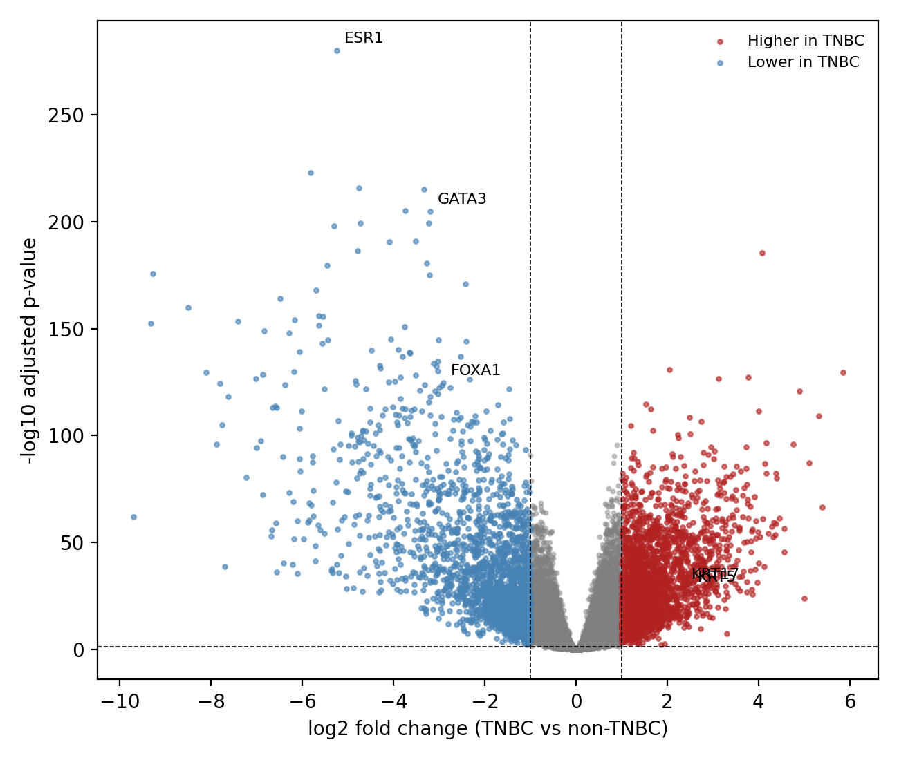
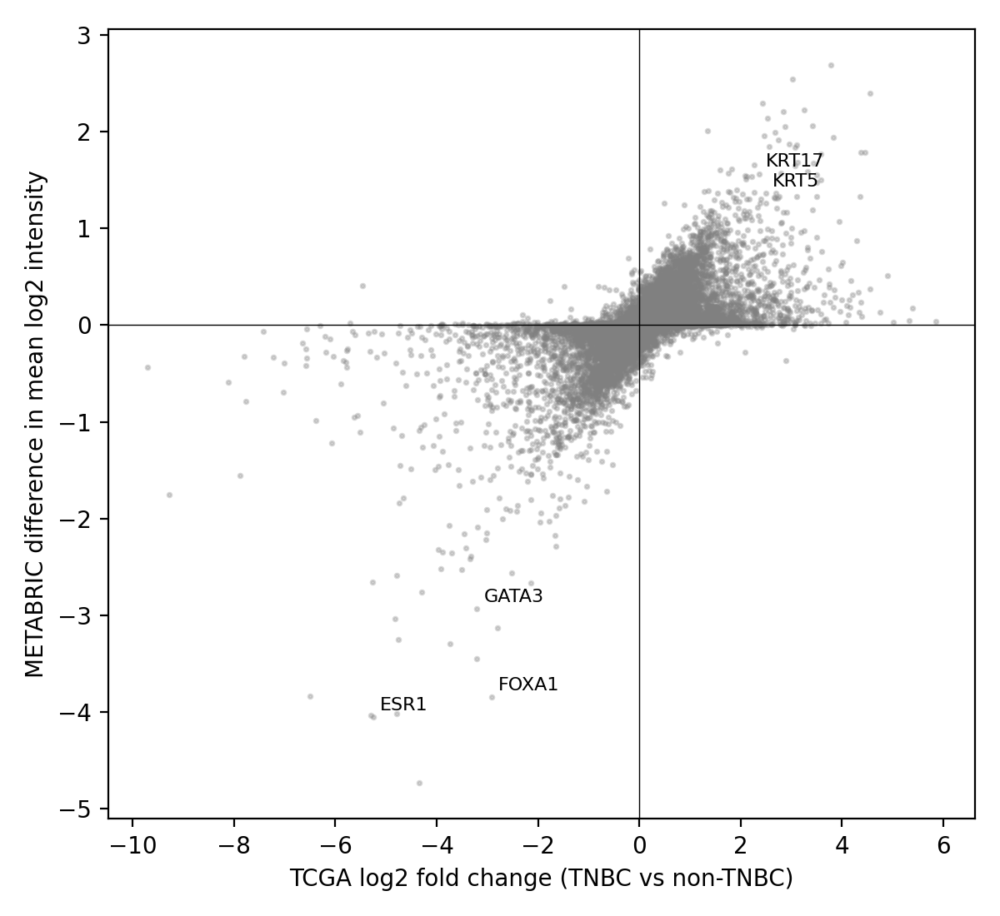

# Differential expression in triple-negative breast cancer: TCGA-BRCA, replicated in METABRIC

I compared triple-negative breast cancer (TNBC) with all other breast cancers in two independent cohorts to see which genes and pathways differ, and whether those differences hold up in a second dataset. The result is mostly a confirmation of known biology: loss of estrogen-response genes and higher cell-cycle activity in TNBC, both of which replicated. A few results did not replicate or I could not interpret, and I report those below.

## The question

Which genes and pathways differ between TNBC and other breast cancers in TCGA-BRCA, and do those differences replicate in METABRIC?

## Data

- **TCGA-BRCA** (discovery): clinical data from the cBioPortal PanCancer Atlas (1,084 patients), receptor status (ER, PR, HER2) from the original TCGA breast study on cBioPortal, and gene-level RNA-seq counts (GDC STAR counts) from UCSC Xena.
- **METABRIC** (replication): clinical and Illumina microarray expression data from cBioPortal (2,509 patients).

## How I defined TNBC

I wrote the rule before looking at any expression data. TNBC means ER, PR and HER2 all negative. Non-TNBC means at least one of the three is positive. Patients with missing or unresolved receptor status were excluded rather than guessed. In TCGA, equivocal HER2 by IHC was settled with FISH where available. Male patients were excluded.

| Cohort | TNBC | Non-TNBC | Excluded |
|---|---|---|---|
| TCGA (clinical file, 1,084 patients) | 142 | 840 | 102 (12 male, 1 unmatched, 89 missing or unresolved status) |
| TCGA (with primary-tumour expression) | 141 | 839 | not used |
| METABRIC (2,509 patients) | 320 | 1,979 | 210 |
| METABRIC (with expression) | 320 | 1,660 | not used |

As checks on the groups: in TCGA, 104 of the 126 TNBC patients with a PAM50 label (83%) were Basal-like. In METABRIC, 246 of the 266 TNBC patients with a three-gene classifier label were ER-/HER2-. About a third of METABRIC's TNBC group (119 of 320) were claudin-low, which TCGA's PAM50 labels do not have as a category, so the two TNBC groups are probably not identical in composition.

## Methods

**TCGA.** Xena stores the counts as log2(count + 1). I reversed this and confirmed the result was whole numbers. I kept one primary tumour sample per patient (the first by barcode order when a patient had more than one). I kept genes with at least 10 counts in at least 141 samples (the size of the smaller group), which left 24,684 of 60,660 genes. I ran differential expression with PyDESeq2 (version 0.5.4), design `~group`, TNBC versus non-TNBC, with Benjamini-Hochberg correction. Fold changes are not shrunk. Ensembl IDs were mapped to gene symbols with the GENCODE v36 annotation file distributed with Xena, and I checked the mapping on ESR1 and GATA3.

**METABRIC.** The expression data are log2 microarray intensities. I averaged 219 duplicated gene symbols, then compared the groups gene by gene with Welch's t-test and Benjamini-Hochberg correction. The effect size is the difference in mean log2 intensity. This is not the full limma method, which borrows information across genes; with about 2,000 samples I expect the difference to be small, but I did not test that.

**Replication.** Because the platforms differ, I compared effect sizes and direction, not p-values. I matched genes by symbol and used the genes measured in both cohorts.

**Pathways.** I tested the MSigDB Hallmark gene sets for over-representation among genes with adjusted p < 0.05 and |log2 fold change| > 1, using GSEApy's offline test with a custom background: the genes I actually tested (24,659 in TCGA, 16,570 in the replication step), not the whole genome.

## Results

### TCGA

19,221 of 24,684 genes had an adjusted p-value below 0.05. With 980 patients, almost any difference reaches significance, so I also required |log2 fold change| > 1. That left 4,655 genes: 2,412 higher and 2,243 lower in TNBC.

As a check on the pipeline, ESR1, GATA3 and FOXA1 were lower in TNBC and KRT5 and KRT17 were higher, which is what known biology predicts.

| Gene | TCGA log2FC | METABRIC difference (log2) |
|---|---|---|
| ESR1 | -5.25 | -4.05 |
| GATA3 | -3.20 | -2.93 |
| FOXA1 | -2.92 | -3.84 |
| KRT5 | +2.50 | +1.36 |
| KRT17 | +2.36 | +1.56 |

### Replication in METABRIC

In METABRIC, 12,708 of 20,384 genes had an adjusted p-value below 0.05, and 355 also had a difference above 1 (131 higher, 224 lower in TNBC). Fewer genes pass the size cutoff than in TCGA, which is expected because microarrays compress the range.

Of the 16,570 genes measured in both cohorts:

- The effect sizes correlated at Spearman 0.78, and 83% of genes moved in the same direction. That 83% is the baseline, since many genes shift together when ER biology differs.
- Of the 4,655 TCGA genes that passed my cutoffs, 2,976 could be compared in METABRIC (the other third are not on the array, many of them non-coding or pseudogenes). Of those 2,976, 94% moved in the same direction and 2,473 (83%) were also significant in METABRIC: 1,366 of 1,622 higher in TNBC and 1,107 of 1,354 lower.

### Pathways

In TCGA, estrogen response (early and late) was strongly lower in TNBC, and G2-M checkpoint, E2F targets and KRAS Signaling Dn were higher. Repeating the test on the genes that replicated in METABRIC (background: the 16,570 shared genes) gave the same picture:

- **Lower in TNBC:** Estrogen Response Early (adjusted p 2e-34) and Late (2e-27), plus Pancreas Beta Cells and Xenobiotic Metabolism (both about 0.025).
- **Higher in TNBC:** G2-M Checkpoint (2e-6), KRAS Signaling Dn (2e-6), E2F Targets (4e-5), and several weaker sets including Inflammatory Response, Allograft Rejection, Hypoxia and Interferon Gamma Response (13 sets in total).

Loss of estrogen response is close to expected, because TNBC is defined by loss of the estrogen receptor. The higher cell-cycle signal fits the faster growth of basal-like tumours and is the more informative result.

## What did not work or is unclear

- **173 genes went the opposite way in METABRIC**, but only 31 of those were significant there, and the differences were small (mostly under 0.4). Several are pseudogenes or members of gene families with near-identical copies (POTEKP, LGALS9B, LGALS9C, MT1A), which may be measured differently on the two platforms. I did not test this.
- **About a third of TCGA's significant genes could not be compared** because they are not in the METABRIC data.
- **The immune-related sets** (Inflammatory Response, Allograft Rejection, Interferon Gamma Response) were higher in TNBC in both cohorts. Because this is bulk tissue, I cannot tell whether the tumour cells themselves differ or whether TNBC tumours simply contain more immune cells.
- **KRAS Signaling Dn** was among the strongest higher-in-TNBC sets. It means genes that go down when KRAS is activated, so it does not show KRAS signalling is active. I do not know how to interpret it, and I make no biological claim from it.
- **GO Biological Process enrichment would not load** (the library download failed on every attempt), so I report Hallmark sets only.

## Limitations

- TNBC is compared with all other breast cancers, so the results reflect ER, PR and HER2 biology as much as anything specific to TNBC.
- The comparison is unadjusted for age, stage or tumour cell composition.
- The groups are uneven (141 against 839 in TCGA), and with this many samples the test flags very small differences, so I relied on a fold-change cutoff as well as the adjusted p-value.
- Receptor status in TCGA came from the original TCGA study and was matched by patient ID. In METABRIC, HER2 status may come from copy number rather than IHC; I did not confirm how it was derived. 11 TCGA TNBC tumours were HER2-enriched, 7 Normal-like and 4 Luminal by PAM50, which reflects disagreement between IHC and expression-based subtypes.
- Both cohorts define TNBC by the same receptor rule, so strong agreement on ER-related genes is expected and is not an independent discovery.
- Fold changes in TCGA are not shrunk, and I did not verify which STAR count column Xena used.
- The METABRIC test is Welch's t-test, not limma.

## How I worked

I wrote this analysis with AI assistance: Claude (Anthropic) helped me write and debug the code and draft this README, and I used Grok to fix some code errors. I ran every step myself in Google Colab, checked the outputs against known biology, and made the decisions about the question, the group definitions and what to report.

## Reproducing this

1. Open the notebook in Google Colab.
2. Run the cells in order. They download the public data, build the groups, run the TCGA analysis, then the METABRIC replication and the pathway tests.
3. The large input files (the counts matrix and the METABRIC expression file) are not stored here. They are public and the notebook downloads them.

Python packages: PyDESeq2 0.5.4, pandas 2.2.3 (newer pandas versions broke PyDESeq2 for me), SciPy, statsmodels, GSEApy, matplotlib.

## Repository contents

- `notebook/`: the analysis notebook
- `figures/`: volcano plot and replication scatter plot
- `results/`: differential expression tables, replicated and non-replicated gene lists, enrichment results

## References

1. Foulkes WD, Smith IE, Reis-Filho JS. Triple-negative breast cancer. N Engl J Med. 2010;363:1938-1948.
2. Cancer Genome Atlas Network. Comprehensive molecular portraits of human breast tumours. Nature. 2012;490:61-70.
3. Curtis C, et al. The genomic and transcriptomic architecture of 2,000 breast tumours reveals novel subgroups. Nature. 2012;486:346-352.
4. Parker JS, et al. Supervised risk predictor of breast cancer based on intrinsic subtypes. J Clin Oncol. 2009;27:1160-1167.
5. Prat A, et al. Phenotypic and molecular characterization of the claudin-low intrinsic subtype of breast cancer. Breast Cancer Res. 2010;12:R68.
6. Cerami E, et al. The cBio cancer genomics portal: an open platform for exploring multidimensional cancer genomics data. Cancer Discov. 2012;2:401-404.
7. Goldman MJ, et al. Visualizing and interpreting cancer genomics data via the Xena platform. Nat Biotechnol. 2020;38:675-678.
8. Love MI, Huber W, Anders S. Moderated estimation of fold change and dispersion for RNA-seq data with DESeq2. Genome Biol. 2014;15:550.
9. Muzellec B, Teleńczuk M, Cabeli V, Andreux M. PyDESeq2: a python package for bulk RNA-seq differential expression analysis. Bioinformatics. 2023;39(9):btad547.
10. Benjamini Y, Hochberg Y. Controlling the false discovery rate: a practical and powerful approach to multiple testing. J R Stat Soc Series B. 1995;57:289-300.
11. Liberzon A, et al. The Molecular Signatures Database Hallmark gene set collection. Cell Syst. 2015;1:417-425.
12. Fang Z, Liu X, Peltz G. GSEApy: a comprehensive package for performing gene set enrichment analysis in Python. Bioinformatics. 2023;39(1):btac757.
13. Kuleshov MV, et al. Enrichr: a comprehensive gene set enrichment analysis web server 2016 update. Nucleic Acids Res. 2016;44:W90-W97.

## Contact

Dickens Agie, dochieng014@gmail.com
